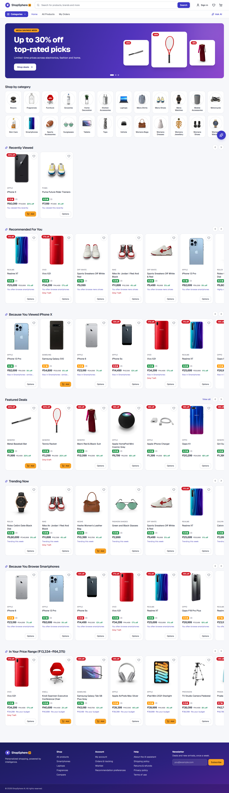
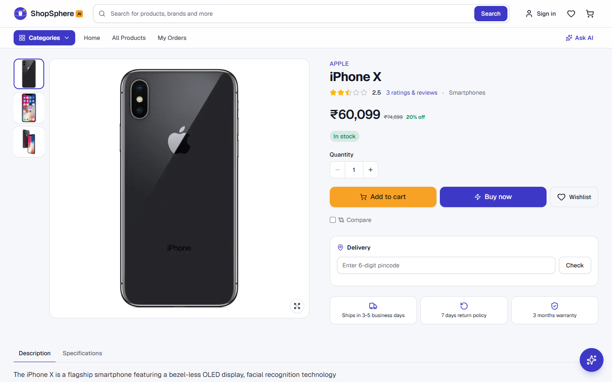
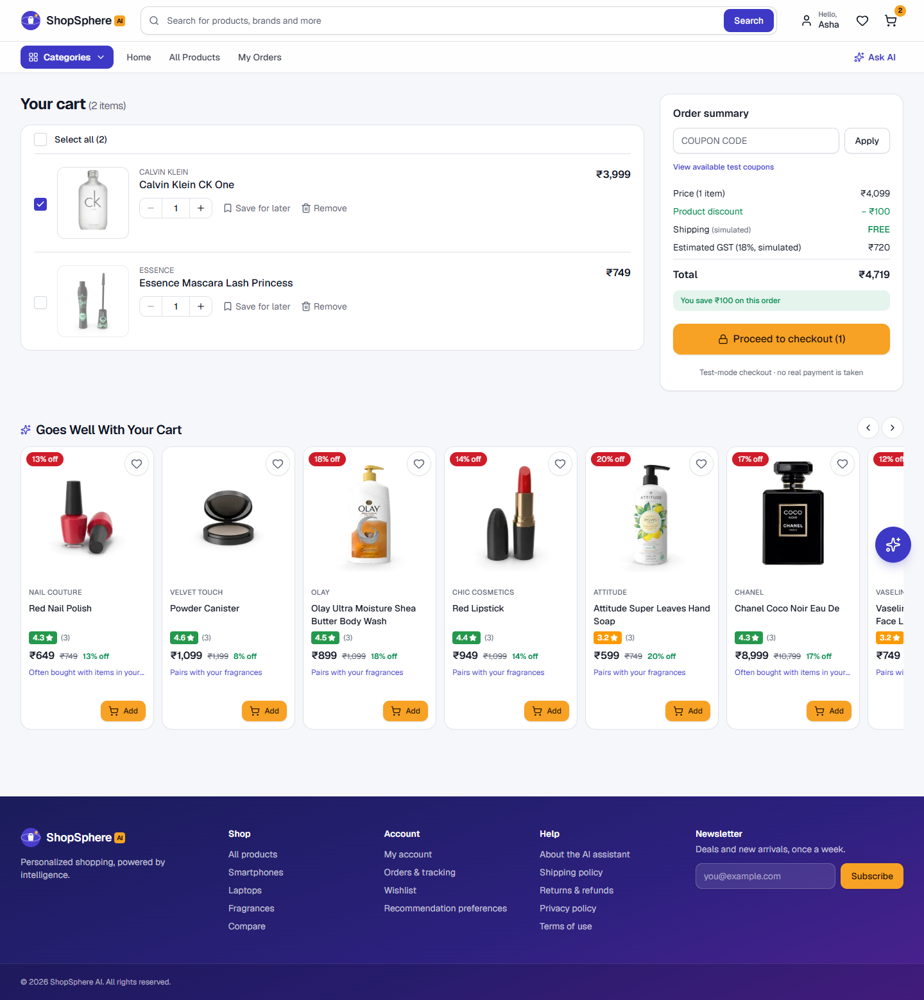
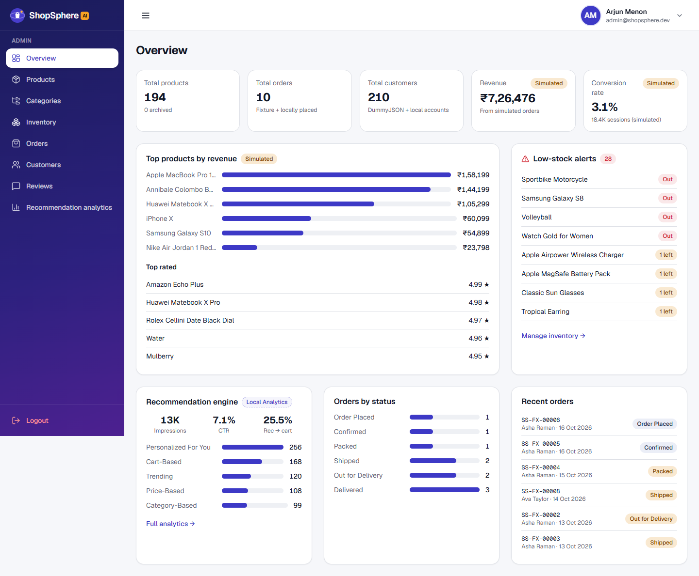

# ShopSphere AI

**Personalized shopping, powered by intelligence.** A production-style e-commerce storefront built with Next.js (App Router) and TypeScript, featuring an explainable 9-strategy recommendation engine, a rule-based conversational shopping assistant, a full simulated commerce loop (cart → checkout → order tracking), and an admin dashboard.

Built to the *ShopSphere AI Product Requirements Document v1.0* — fully on free / open-source tooling, with **no API keys, paid services or real payments** (PRD §2).



---

## Contents

- [Features](#features)
- [Screenshots](#screenshots)
- [Tech stack](#tech-stack)
- [Getting started](#getting-started)
- [Environment variables](#environment-variables)
- [Scripts](#scripts)
- [Demo accounts](#demo-accounts)
- [Project structure](#project-structure)
- [Recommendation scoring model](#recommendation-scoring-model)
- [Key product decisions](#key-product-decisions)
- [Testing](#testing)
- [Deployment](#deployment)
- [Known limitations](#known-limitations)
- [Documentation](#documentation)

---

## Features

| Area | Highlights | PRD |
|---|---|---|
| **Landing page** | Hero, category tiles, Featured Deals, Trending, *Recommended For You* (falls back to *Popular Right Now* for first-time visitors), Recently Viewed, *Because You Viewed …* | MOD-01 |
| **Discovery** | Responsive grid (2 → 5 columns), price slider + inputs (auto-swaps inverted ranges), rating, availability, on-sale, brand/category multi-select, 5 sort orders, active-filter chips, URL-driven pagination, Quick View, compare 2–4 products | MOD-02 |
| **Search** | 350 ms debounced live suggestions (products + categories), recent searches with clear, popular searches, URL state (shareable + back/forward), "Did you mean …?" spelling suggestions | MOD-03 |
| **Product page** | Gallery with thumbnails, zoom-on-hover and lightbox; size/colour variants (sold-out variants disabled); stock-bounded quantity; Add to cart / Buy now; pincode delivery estimate; description/specs tabs; 4 distinct recommendation rails | MOD-04 |
| **Cart** | Tick which items to check out (Select all), quantity clamping, coupons (valid / invalid / expired / minimum-order), save for later, shipping + GST simulation, cart-based recommendations, and every §5.5 failure path (out of stock, insufficient stock, removed product, price change, API failure with cached fallback) | MOD-05 |
| **Checkout** | 6 steps: customer → address (saved addresses) → delivery speed → summary → **test-mode** payment (card / UPI / COD scenarios, never real card fields) → confirmation. Survives refresh and session expiry | MOD-06 |
| **Account** | Profile + avatar with saved addresses, orders, my reviews, **Recommendation Preferences transparency panel**; wishlist and recently viewed from the header and home page | MOD-07 |
| **Order tracking** | 6-stage timeline with timestamps; simulated logistics clock + admin "advance" control | MOD-08 |
| **Wishlist** | Live price/stock, price-drop badge, move to cart, wishlist-based rail. Guests get a device cart and a session-only wishlist, merged into their account on sign-in (PRD §4.3) | MOD-09 |
| **Reviews** | Written from a delivered order (star rating + 3–1000 characters, edit later), admin can hide/show, sort (recent/highest/lowest/helpful), rating distribution chart, helpful votes, verified-purchase badge derived from local order history | MOD-10 |
| **Recommendations** | 9 strategies, weighted composite scoring, signal-transparent rail titles, layered hook → service → provider → engine architecture | §6 |
| **AI Shopping Assistant** | Rule-based intent parsing (category, budget, rating, colour, brand, gender), conversational refinement (cheaper / better rated / only in blue / more like #2 / topic change), inline product cards, clarifying fallback | §7 |
| **Admin dashboard** | KPIs (simulated revenue & conversion clearly labelled), top products, low-stock alerts, product CRUD (delete blocked → archive when referenced by orders), categories, inventory, orders with filters + status advance, customers, review moderation (hide/show, delete customer reviews), recommendation analytics ("Local Analytics") | §8, §4.3 |

## Screenshots

| Product page | Cart (item selection) | Admin overview |
|---|---|---|
|  |  |  |

All 37 screens (storefront, checkout, account and every admin page) at 390 px, 820 px and 1440 px are in [`docs/screenshots/`](docs/screenshots/) (`mobile/`, `tablet/`, `desktop/`). Regenerate with `npm run screenshots`.

## Tech stack

| Layer | Choice |
|---|---|
| Framework | **Next.js 16** (App Router, Turbopack) + **React 19** |
| Language | **TypeScript** (strict) |
| Styling / UI | **Tailwind CSS v4** + shadcn/ui-style components on **Radix UI** primitives, `lucide-react` icons, Geist font |
| Client state | **Zustand** (persisted, cross-tab synced) |
| Server/cache state | **TanStack Query v5** (+ localStorage persistence of the catalogue for offline/failed refetches) |
| Forms & validation | React Hook Form + Zod |
| Data | **DummyJSON** + local JSON fixtures (`src/mocks/`) |
| Testing | **Vitest**, **React Testing Library**, **Playwright** |
| CI | GitHub Actions (typecheck, lint, unit/component, build, E2E) |

## Getting started

Requirements: **Node.js 20.9+** (Node 22 LTS recommended) and npm.

```bash
git clone <your-repo-url> shopsphere-ai
cd shopsphere-ai
npm install
cp .env.example .env.local     # optional — defaults work out of the box
npm run dev                    # http://localhost:3000
```

**Offline mode.** No internet, or DummyJSON is down? Run against the bundled snapshot of DummyJSON's data (with locally generated product artwork):

```bash
npm run dev:mock               # same as NEXT_PUBLIC_PRODUCT_API_URL=/api/mock
```

## Environment variables

All are optional and public (no secrets exist in this project). See [`.env.example`](.env.example).

| Variable | Default | Purpose |
|---|---|---|
| `NEXT_PUBLIC_PRODUCT_API_URL` | `https://dummyjson.com` | Product API base URL. Use `/api/mock` for the offline snapshot. |
| `NEXT_PUBLIC_SESSION_TTL_MINUTES` | `30` | Inactivity timeout for the mock session. |
| `NEXT_PUBLIC_USD_TO_INR` | `83` | Conversion applied to DummyJSON's USD prices. |

## Scripts

| Script | What it does |
|---|---|
| `npm run dev` / `dev:mock` | Dev server (live DummyJSON / offline snapshot) |
| `npm run build` / `start` | Production build / serve |
| `npm run typecheck` | `tsc --noEmit` |
| `npm run lint` | ESLint (Next core-web-vitals + TypeScript + an architecture guard that forbids React imports in `services/`) |
| `npm test` | Unit + component tests (Vitest + RTL) |
| `npm run test:coverage` | Same, with coverage |
| `npm run test:e2e` | Playwright E2E (builds and serves with the offline mock automatically). First run: `npx playwright install chromium` |
| `npm run check` | typecheck + lint + tests |
| `npm run screenshots` | Captures all 37 screens at mobile / tablet / desktop into `docs/screenshots/` (live DummyJSON photos — needs internet) |
| `npm run screenshots:mock` | Same, using the offline mock API (placeholder product art) |

## Roles & access

One website, one sign-in page, two roles:

| | Guest | Customer | Admin |
|---|---|---|---|
| Browse, search, product pages | ✅ | ✅ | ✅ (read-only) |
| AI shopping assistant | ✅ | ✅ | — (customer feature) |
| Reviews | read | read + write | moderate (`/admin/reviews`) |
| Cart | ✅ (this device) | ✅ (saved to account) | → redirected to `/admin` |
| Wishlist | ✅ (this session only) | ✅ | → redirected to `/admin` |
| Checkout, orders, account | → sign in | ✅ | → redirected to `/admin` |
| Admin dashboard (`/admin/*`) | → sign in | → `/forbidden` | ✅ |

- After signing in, **admins land on `/admin`** and **customers return to the page they were on** (`src/lib/role-routing.ts`).
- Routes are protected twice: `src/proxy.ts` redirects on the server before render, and `RequireAuth` re-checks the session and role on the client.
- New registrations are always customers; admin accounts are seeded (mock auth, PRD §11).

## Demo accounts

Local development accounts (PRD §21) — type these on the sign-in page:

| Role | Email | Password |
|---|---|---|
| Customer | `customer@shopsphere.dev` | `Customer@123` |
| Administrator | `admin@shopsphere.dev` | `Admin@123` |

Any DummyJSON user also works via its `/auth/login` endpoint, e.g. `emilys` / `emilyspass` (an admin). You can also register a new local account.

The customer account ships with fixture orders in **every** tracking status, so order tracking can be evaluated immediately.

## Project structure

```
src/
  app/                    Next.js App Router routes
    (store)/              storefront route group (header/footer layout)
    admin/                admin dashboard (role-gated layout)
    api/mock/[...path]/   offline DummyJSON stand-in (dev + E2E)
  components/             shared UI: ui/ (shadcn-style primitives), common/, layout/, providers/
  features/               feature modules — components + hooks per domain
    auth/ products/ search/ cart/ wishlist/ checkout/ orders/
    recommendations/ ai-assistant/ reviews/ account/ admin/ home/
  hooks/                  cross-feature hooks (debounce, online status)
  services/               framework-agnostic logic — NO React (lint-enforced)
    api/                  HTTP client, Zod schemas, DummyJSON endpoints
    catalog/              normalization, filtering/sorting, admin overrides
    recommendations/      service → provider → engine (signals, scoring, strategies)
    assistant/            intent parser, lexicon, assistant service, provider
    cart/ checkout/ orders/ reviews/ delivery/ auth/ analytics/
  store/                  Zustand stores (client state only)
  lib/                    env, constants, formatters, validation schemas, URL state
  types/                  shared domain types
  utils/                  pure helpers
  mocks/                  fixtures: orders, reviews, recommendations, user-preferences, analytics (+ DummyJSON snapshot)
  proxy.ts                edge guard for protected routes
tests/  unit/ component/ helpers/
e2e/    Playwright specs (+ screenshots/)
```

## Recommendation scoring model

Every candidate gets a weighted composite score; each component is normalized to `[0, 1]` and the weights sum to 1 (PRD §6.2):

```
score = 0.24·categoryMatch + 0.14·priceSimilarity + 0.18·tagOverlap + 0.10·normalizedRating
      + 0.14·recentlyViewedRelation + 0.08·wishlistRelation + 0.12·cartRelation
```

With few signals the engine blends in popularity (`score = confidence·personal + (1 − confidence)·popularity`, confidence saturating at 6 signals) so a single page view doesn't over-steer the feed.

## Key product decisions

Where the PRD left room for judgement (PRD §26), these decisions were made and documented:

- **INR storefront.** DummyJSON prices are USD; they're converted (`× 83`, configurable) and rounded to retail price points. `price` from DummyJSON is treated as MRP and `discountPercentage` produces the selling price.
- **Variants.** DummyJSON has none, so deterministic size/colour variants are derived for apparel, footwear, phones, bags, watches and sunglasses, splitting the product's stock. About a third get one sold-out variant on purpose to exercise MOD-04-001.
- **Client-side filtering.** DummyJSON can't filter by price/rating/brand, so the full catalogue (194 products, `limit=0`) is fetched once, cached by TanStack Query, and filtered/sorted/paginated in a pure service. Search uses `/products/search`.
- **Pagination, not infinite scroll** — URL-addressable pages are shareable, accessible and keep the back button predictable.
- **Persistence scope.** Orders, reviews, addresses, admin edits and analytics persist to `localStorage` of this browser (PRD §10.1); admin screens label this "Saved locally".
- **Auth** is JWT-shaped but local (see [Known limitations](#known-limitations)). A non-sensitive `role.expiry` cookie lets `proxy.ts` redirect unauthenticated requests before render; client guards re-validate the full session.

## Testing

```
Unit + component (Vitest/RTL): 152 tests
E2E (Playwright):              31 tests
```

Dedicated suites cover the scoring model, all nine strategies, the intent parser and the assistant conversation flows. Full results, coverage and known gaps: [docs/TESTING_REPORT.md](docs/TESTING_REPORT.md).

## Deployment

The app deploys to any Next.js host; **Vercel Hobby** (free) is the simplest:

1. Push the repo to GitHub.
2. Import it at vercel.com → *New Project* (framework auto-detected).
3. Optionally set the env vars above (none are required).
4. Deploy, then run the E2E suite against it: `E2E_BASE_URL=https://your-app.vercel.app npm run test:e2e`.

> Note: E2E tests that mutate data assume the mock API's deterministic catalogue; against the live DummyJSON API, run the read-only flows or set `NEXT_PUBLIC_PRODUCT_API_URL=/api/mock` on a preview deployment.

## Known limitations

These are deliberate, development-stage boundaries (PRD §1.4 non-goals, §25):

- **Authentication** — passwords for locally registered accounts are SHA-256 hashed in the browser and the token is unsigned. A production system would hash server-side with a slow KDF behind an identity provider and use signed, rotating tokens.
- **Persistence** — everything written (orders, reviews, admin edits) lives in this browser's storage; DummyJSON writes are not persisted. A backend database is the next build phase.
- **Payments** are simulated test scenarios; no field ever requests real card, CVV, bank or UPI-PIN data.
- **Assistant** is rule-based by design. An LLM provider can implement the same `AssistantProvider` interface server-side without UI changes.

## Documentation

| Document | Covers |
|---|---|
| [Architecture](docs/ARCHITECTURE.md) | Layers, folder structure, data flow, state, routing and guards, shared UI building blocks |
| [Recommendation engine](docs/RECOMMENDATION_ENGINE.md) | Signals, scoring formula, the 9 strategies, fallbacks, transparency |
| [AI shopping assistant](docs/AI_ASSISTANT.md) | Intent parsing, conversation refinement, provider interface |
| [API integration](docs/API_INTEGRATION.md) | DummyJSON endpoints, validation, normalisation, local fixtures, offline mock API |
| [Edge cases](docs/EDGE_CASES.md) | How each of the PRD's 27 edge cases is handled |
| [Testing report](docs/TESTING_REPORT.md) | Unit, component and E2E suites, coverage, known gaps |
| [Git workflow](docs/GIT_WORKFLOW.md) | Branches, commit convention, PR checklist |
